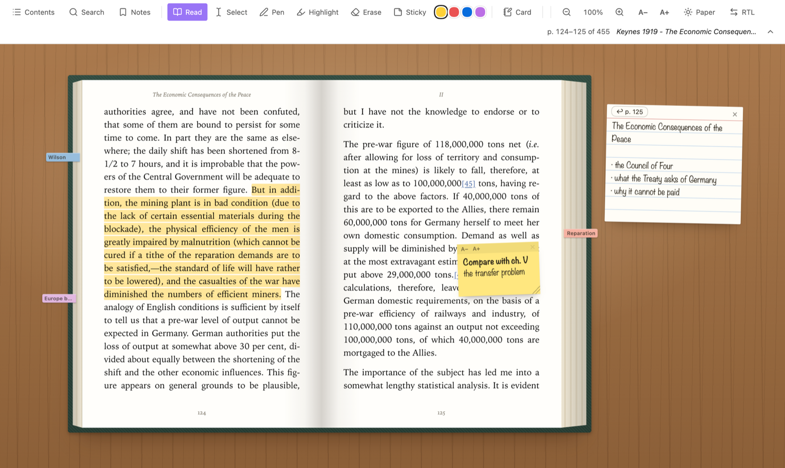

# Book Desk

Read PDF and EPUB books in Obsidian the way you read a paper book: a book that lies open on a desk, with pages that turn,
edges that show how far you are, a pen, a highlighter, sticky notes and index cards.



## What you can do

- **Turn pages** by dragging a corner, tapping the outer edge, or with the arrow keys. The page edges show the book's
  thickness: point at them to see a page number, click to open there.
- **Write on the page** with the pen, draw with the highlighter, rub things out with the eraser.
- **Highlight text.** A highlight is saved as a link in a note of yours, with the quoted words. The book file is never
  changed. The links use the format of [PDF++](https://github.com/RyotaUshio/obsidian-pdf-plus), so both plugins show
  the same highlights. Click a highlight to open the note it lives in.
- **Stick notes on pages.** Each sticky note leaves a small flag on the page edge, so you can find the page again.
- **Keep index cards** beside the book. Each card remembers the page it was written on.
- **Search** the book, open its **contents**, and see everything you have marked in one **notes panel**.
- **Select text** to copy it, or to copy it as a quote with a link back to the page. On a PDF the selection follows the
  order the page is read in, also where the file itself stores a right-to-left line backwards (as many Persian and
  Arabic PDFs do), so the words you copy, search for and quote come out right.
- **Read EPUBs** as pages too, with the text size you like. Your place survives a change of text size.
- **Right-to-left books** (Persian, Arabic, Hebrew) open with the spine on the right.
- **Paper, sepia and night** page colours.
- **Read on an [Excalidraw](https://github.com/zsviczian/obsidian-excalidraw-plugin) drawing**: drag a book's `.desk`
  file onto a drawing, or run **Put a book on this Excalidraw drawing**.

## How to start

1. Open a PDF, or a note that links to one, and run **Open this book on the desk** (also in the file menu and the
   ribbon). EPUB files open on the desk by themselves.
2. A card on the desk explains the tools the first time. Press <kbd>T</kbd> to hide the toolbar, <kbd>S</kbd> to select
   text, <kbd>/</kbd> to search.

### The book's note

A *book's note* is the note that keeps the book's highlights. It is a note whose properties link to the book, for
example:

```yaml
---
book: "[[My Book.pdf]]"
---
```

If you keep a note for every book in one folder, name that folder in the settings: then any note in it that links to the
book is its note, wherever the link is.

The first time you highlight a book that has no note, the desk asks whether to make one (named after the book, in the
book notes folder or wherever Obsidian puts new notes), to use a note you choose (it gets a `book` property linking to
the book), or only to copy the highlight.

New highlights go under a heading of the book's note (*Highlights* unless you choose another). The note can also keep
the page you are on and the page count in properties you name in the settings. A `language` (or `lang`) property such
as `fa`, `ar` or `he` opens the book right to left; without one, the desk looks at the book's text.

## Where your work is kept

| What | Where |
| --- | --- |
| The page you are on, pen marks, sticky notes, cards, zoom | A small `.desk` file per book (JSON), in the desk folder you choose in the settings. It syncs with your vault. With Obsidian Sync, turn on **Sync all other types** in its settings, or desks stay on the device they were made on (EPUB files need it too). |
| Text highlights | Links in your own notes. Delete the link and the highlight is gone. |
| Settings | The plugin's own data file. |

The book files themselves are only ever read. If a PDF is replaced by a shorter file (another edition, or a small
placeholder), its desk keeps your place until you turn a page.

## Privacy and safety

- **No network use.** The plugin never connects to anything. There is no telemetry, no account and nothing to pay for.
- **Nothing outside your vault** is read or written.
- **The clipboard** is written when you copy text, copy a quote, or make a highlight.
- **Books are treated as untrusted.** An EPUB is a set of web pages written by someone else, so before a chapter is
  shown, everything that could run (scripts, event handlers, forms, frames, plug-ins) is removed, and nothing in it can
  load anything from the web: every picture and font must be inside the book file. The book's styles are confined to
  its own pages. A link in a book opens in your browser only if it is a plain web or mail address. Text copied from a
  book into a note is written as plain text, so it cannot turn into an embed, a web picture or a script there.
- **Other plugins.** If PDF++ is installed, its colours and its copy format are read (never changed), so highlights
  look the same in both. If Excalidraw is installed, its scripting interface is used to put a desk on a drawing. Both
  are optional.

## Limits

- Copy-protected (DRM) EPUBs cannot be opened.
- EPUBs with a fixed page layout (comics, some picture books) are shown as flowing text and may look wrong.
- Sound, video and scripts inside EPUBs are left out.
- Pen marks on an EPUB page belong to that page: after a change of text size the words move, the ink does not.
- Scanned PDFs have no text to select, highlight or search.
- In a PDF that does not store its right-to-left lines in reading order, a highlight that starts or ends in the middle
  of a line is written as several links (the format holds one unbroken stretch of the file per link); the first
  carries the words.
- Needs Obsidian 1.13 or later. EPUBs on iPhone and iPad need iOS 16.4 or later.

## Development

```sh
npm install
npm run build   # bundles src/ into main.js
npm test        # unit tests (Node)
npm run lint    # the rules of Obsidian's own plugin review
```

`tests/app/` holds tests that run inside a running Obsidian, among them a hostile EPUB that tries every way to run
script, fetch from the web, or leave its page; see [tests/app/README.md](tests/app/README.md).

## Credits

- [PDF++](https://github.com/RyotaUshio/obsidian-pdf-plus) by Ryota Ushio, for the highlight link format and the
  geometry of highlights. See [THIRD-PARTY-NOTICES.md](THIRD-PARTY-NOTICES.md).
- PDF pages are drawn by the PDF.js that ships with Obsidian.

## License

[MIT](LICENSE)
